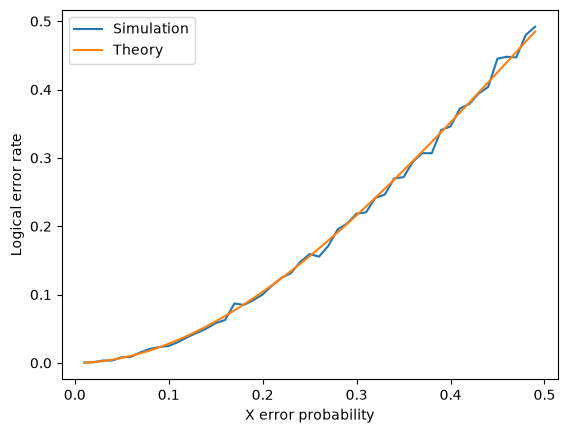

# QEC Decoder Benchmark

An independent quantum error-correction project built from first principles, exploring stabiliser codes, noisy syndrome extraction, and decoding (inc. MWPM). The project aims to investigate decoder performance under noise-model mismatch, using established tools such as Stim and PyMatching for cross-checks and larger-scale experiments.

## Research Question

How does logical error rate change when a decoder's assumed noise model differs from the true physical noise? In particular, how sensitive is MWPM decoding to incorrect estimates of data-qubit and measurement error rates?

## Implemented

- **State-vector simulator:** quantum gates, measurement, and ancilla reset.
- **Stabiliser simulator:** representation and manipulation of stabiliser states and operators.
- **3-qubit repetition code:** bit-flip noise, syndrome extraction, decoding, and logical-error-rate estimation.
- **9-qubit Shor code:** stabiliser definitions, physical error tracking, syndrome extraction, and decoding experiments.
- **Toric code:** stabiliser structure and matching-based decoding, extending the project to a topological quantum error-correcting code.
- **Repeated syndrome extraction:** multiple noisy measurement rounds, detector-event generation, and space-time decoding.
- **MWPM decoding:** construction of weighted matching graphs and integration with PyMatching.

## Validation and Experiments

- Compared the single-round repetition-code logical error rate against the analytical majority-vote result:

  \[
  P_L = 3p^2 - 2p^3
  \]

  
- Investigated the effects of physical bit-flip noise and syndrome-measurement noise on decoding performance.
- Explored space-time decoding graphs, detector events, and boundary handling.
- Extended the implementation from a repetition code to the Shor and toric codes.

## In Progress

- Validating repeated-round decoding, including temporal boundaries and noisy syndrome histories.
- Systematically separating logical failures from residual errors that leave the code space.
- Benchmarking decoding performance under noise-model mismatch.
- Cross-checking custom implementations against established decoding tools.
- Extending experiments to compare code families and noise assumptions.

## Repository Structure

- `state_sim/` — state-vector simulation.
- `stabilizer_sim/` — stabiliser simulation.
- `report/` — research notes, analysis, and results.
- `figs/` — figures generated by experiments.

## Project Direction

The next stage is to establish reliable baselines for each code and decoder, then investigate how decoding performance degrades under noise-model mismatch. Aiming to to build a reproducible benchmark with clearly defined metrics, controlled experiments, and comparisons against established decoding methods.